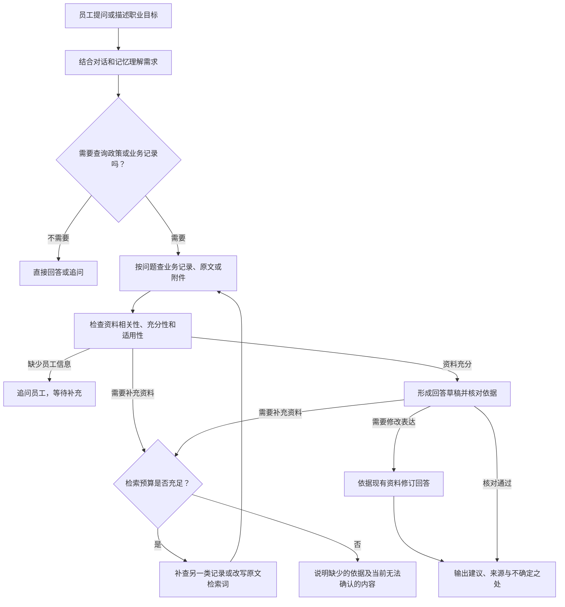

# 员工职业规划问答智能体：Agentic RAG 方案

> 更新：2026-11-19
>
> author: jiangguoyun

## 1. 目标与使用方式

员工用日常语言提问。首版使用一个证书与职称知识库，Agent 根据问题选择查业务记录、查政策原文或取报名附件。一次提问可以用到多种查询。

首版处理证书、职称、奖励和办理指引。需要检索时，分别查结构化记录和对应政策原文；缺少决定适用范围的员工信息时先追问。最终给出建议、依据和无法确认的内容，不代办申报或审批。

能力上通过 Agent 的工具选择、检索循环、结果核实、记忆和上下文管理，再根据真实案例判断是否需要扩展。

## 2. 架构选择

采用 **Agent + Agentic RAG + 检索与回答校验**。

Agentic RAG 表示由模型决定检索时机、检索问题和工具选择；提供了按需检索、反思或纠正检索的相关研究思路，本文采用这些思路进行工程设计。

Agent 负责运行循环、工具调用、Skill、记忆和上下文管理基础。
实际知识库检索、资料适用性判断规则和业务验收需要另外设计，框架不保证回答正确。

## 3. 职责分工

| 部分 | 职责 |
|---|---|
| 主 Agent | 理解员工需求，选择查询工具，核对结果，决定回答或追问 |
| 职业规划 Skill | 规定如何处理职业问题、选择知识来源、核实资料、引用依据与说明不足 |
| 检索工具 | 执行真实查询，返回资料片段及结构化来源信息 |
| 知识库 | 提供已整理的公司与集团制度、北京职称政策、证书对应、奖励目录、时间事项和通知附件 |
| 当前会话与上下文 | 保存本次交流中的问题、补充信息、工具结果和分析进度 |
| 长期记忆 | 保存用户确认的职业目标、背景或交流偏好，支持后续会话 |
| 业务后端 | 验证身份、限制资料访问、控制工具调用预算和数据读写权限 |

Agent 给工具传员工提到的证书、目标职称、地区等业务参数。工具负责选择表、字段和查询条件，后端根据登录身份限定访问范围。

## 4. 核心运行流程

不要求每个问题都检索。例如澄清问题、整理用户刚提供的信息和一般性交流，可以直接处理。
涉及具体公司规定的结论必须有可核对的公司资料支持。

## 5. 知识与检索工具

### 5.1 知识来源

PostgreSQL 的 `career.public` 保存来源、正文、证书对应、奖励、年度时间事项和附件关系；Milvus 的 `career.career_policy_sections` 是可从正文重建的检索索引。首版一条正文对应一条索引记录，检索文本为「章名＋正文」，不拼文件标题。使用 Qwen/Qwen3-VL-Embedding-8B 生成 1024 维稠密向量，Milvus 生成 BM25 稀疏向量。

### 5.2 工具接口

首版按下面的职责接工具。**已有数据及独立查询脚本，工具尚未注册到网页 Agent。**

| 工具职责 | 查询路径 |
|---|---|
| “一建对应什么职称？” | 用 `kb1_certificate_aliases` 将“一建”归一为“一级建造师”，再查 `kb1_mappings` 的职称、条件和出处。渠道未知时可列出北京、集团两套结果，分别说明条件。默认只引用 `record_status = 'review_ready'` 且来源现行有效的记录，两条存在来源冲突的国际对应关系不参与默认回答。 |
| “一建机电奖励多少？” | 查 `kb1_rewards` 的证书名、专业分项、金额、周期和条件，再按同一 `source_id` 取 `kb1_shared_rules` 的目录共用说明。组合奖励按一条奖励解释。回答注明目录年度，2025 年目录在 2026 年是否沿用仍待确认。`blue_display_names` 用于网页标蓝，职称认定另查对应表。 |
| “集团高工什么时候截止？” | 查 `kb1_schedules`，按通知年度和 `event_type` 区分报名、材料提交和资历计算，再从 `evidence_section_id` 回查原文。日期只有预计时间时，保留原文措辞。 |
| “评高级工程师需要哪些条件？” | 先在 PostgreSQL 按来源处理状态、有效状态和已知的渠道、地区、年度、文件类型找可用正文。按年度查询时，也保留适用的常设办法。用同一份 `source_id` 清单限制 Milvus 的稠密和 BM25 两路检索，合并候选、重排，按最终命中的 `section_id` 回查原文。清单为空时说明缺少相应资料。 |
| 按文号找文件 | PostgreSQL 用正式文号和已知别名定位；多个候选按年度或发文单位区分。点名 182 号时，从印发通知沿知识性附件关系找到办法正文。 |
| 列出报名附件 | 按具体主通知的 `source_id` 查关系，网页只提供经过权限检查的下载入口。 |

### 5.3 员工如何核对答案

- **政策条款**按 Milvus 命中的 `section_id` 读取 `kb1_sections.id` 对应的完整正文、章名和原件位置，同时核对文件 `source_id`。展示文件名以及有记录的条款、页码或段落。每版文件有独立的来源 ID，生效日期只在材料有依据时展示。
- **金额、对应关系和日期**保留业务记录自己的文件出处。有 `evidence_section_id` 时可回到条款；奖励或对应记录缺少条款 ID 时，可引用文件名和已记录的工作表行、单元格或原件位置。具体专业、职称、年限等适用条件从业务记录和原文读取。
- **报名模板**从主通知的附件关系取显示名称和下载策略。模板可以供下载，毋须有条款 ID。网页下载入口待接入。

例如员工只说“我本科机械工程，工作 5 年，有一建，想评高工”。从这句话能提取已持证书“一建”和目标“高级工程师”，无法确定申报渠道，也无法确定取得前置职称后的工作年限。工具可先用“一建”查出分渠道的对应记录；Agent 再问“你准备走集团内部评审，还是地方人社评审？如果是地方，在哪个省市？”有了渠道后查该渠道的高工条件，再按条款追问缺少的资历信息。只有证书对应记录，还不足以判断员工已具备申报资格。

检索分数可辅助排序，但不等同于资料正确、适用或足以回答问题。

## 6. 两层核实

### 6.1 检索结果核实

Agent 取得资料后检查：

1. 相关性：是否针对当前问题与目标岗位。
2. 适用性：版本、时间、部门、岗位及人员范围是否匹配。
3. 充分性：是否覆盖主要问题，是否还需要其他资料。
4. 一致性：资料之间是否有冲突，是否需要进一步确定适用版本。

处理方式应对应具体不足：检索问题不准确就改写，缺少其他方面资料就补检索，缺少员工信息就追问。
连续没有找到有效依据时，明确说明不足。

### 6.2 回答核实

回答前检查：

- 是否回答了员工实际关心的问题。
- 公司制度相关的结论是否有检索依据，引用是否支持对应结论。
- 是否清楚区分公司要求、员工提供的信息与 Agent 的建议。
- 是否保留尚未确认的条件，避免直接作出缺乏依据的资格判断。

首版可由同一个主 Agent 完成这些检查，先通过 Skill 约束并在评估中检查实际效果。
若后续需要程序化强制校验，再加入独立校验步骤或中间件；不默认新增一个评审 Agent。
模型自检属于处理环节，仍需独立的业务案例验收，不能把模型自评当作准确率证明。

## 7. 职业规划 Skill 的内容

Skill 覆盖：

- 了解员工当前岗位、经历、目标和主要困惑。
- 按问题选择业务记录、政策条款或附件，必要时拆分检索问题。
- 对公司制度相关断言提供资料依据。
- 检查资料的相关性、充分性、适用范围和版本。
- 资料不足时继续检索、追问或说明无法确认，不自行补造公司规定。
- 回答中区分制度事实、员工信息和职业建议。
- 记忆的保存范围、用户确认要求与纠正方式。

Skill 中描述这些业务原则；实际检索和存储通过工具完成。

## 8. 记忆与上下文管理

### 8.1 当前会话

使用对话历史理解连续提问。例如员工先说“我想晋升高工”，再问“需要哪些条件”，
应结合前文形成完整的检索问题。

使用检查点支持跨请求继续交流；长对话通过框架上下文管理处理。
实际模型的上下文上限、摘要效果和检索结果长度需要用真实案例验证。

### 8.2 长期信息

员工确认的专业、学历、工作经历、已持证书及目标进入个人记忆。登录、会话和记忆保存在 PostgreSQL 的 `career.deep_agent`，政策资料保存在 `career.public`。首版暂不对接员工系统，也不单建画像表。

使用边界：

- 用户事实与模型推测分别处理，不将推测自动变成员工事实。
- 公司规章制度以适用知识来源为准，不能用历史记忆代替当前制度依据。
- 用户能够查看、修改和清空自己的记忆，并按用户隔离。

## 9. 自主行为与停止边界

模型负责判断检索策略，业务代码执行必要边界：

- 身份与数据权限在后端验证，检索工具只返回当前用户有权访问的资料。
- 公司具体制度断言应有依据；无依据时说明无法确认。
- 对每轮提问设置检索次数、模型调用或运行时间预算，避免无效循环。
- 建议起点为每轮最多 3 次检索（首次检索加最多 2 次补检索），具体效果待实测，当前非已确定的业务要求。
- 到达预算、反复无新结果或资料存在未解决冲突时，结束当前检索并解释缺口或追问员工。
- 外部政策查询先预留客户 WebSearch 工具；外部检索结果不能充当公司内部规定。

## 10. 首版范围与实施前准备

首版能力组合：

**单个 Agent + 职业规划 Skill + 知识库检索工具 + 用户记忆 + 会话持久化 + 流式回答。**

结构化规划结果可在具体输出要求明确后加入。

第一批已入库。河北专业目录和汇编、培训攻略、渠道简介共 7 份尚未清洗；正式报销流程仍缺材料。问河北具体专业条件、报销办理步骤或仅出现在操作手册截图中的按钮时，应指出证据缺口。网页下一步是注册查询工具，联调混合检索、重排和引用回查。数据与接入进度见[项目状态](../PROJECT_STATUS.md)，逐份材料见[处理待办](../证书资料处理待办.md)。

## 11. 验收案例方向

| 场景 | 期望行为 |
|---|---|
| 一般交流或澄清 | 可直接回答或追问，不无意义检索 |
| 明确查询公司制度 | 查适用的制度原文，回答引用文件名和条款 |
| 机械工程本科、工作 5 年、有一建、想评高工 | 从原话选工具，不预填文件编号或渠道；必要时追问，区分总工龄和取得前置职称后的年限，并回查原文 |
| 一建在集团和北京分别对应什么 | 分渠道返回各自条件和出处，不把北京政策当作集团依据 |
| 点名「182 号」或问集团高工截止 | 查对通知和正文；区分报名、材料提交和资历计算期限 |
| 多轮省略提问 | 结合前文形成完整检索问题 |
| 首次资料不相关 | 调整查询后再检索，保留最终有效来源 |
| 缺少员工信息 | 追问，不将信息缺失误判为不满足条件 |
| 资料不足、过期或冲突 | 说明限制，补检索或停止，不编造制度 |
| 重复检索无进展 | 在预算内终止并解释不足 |
| 不同员工访问 | 工具、会话和记忆均遵守后端权限 |
| 记忆被修改 | 后续回答按已定义的刷新策略使用最新信息 |

通过真实案例记录工具选择、检索结果、引用、回答和调用成本，再判断是否需要增加其他 Agent 能力。
