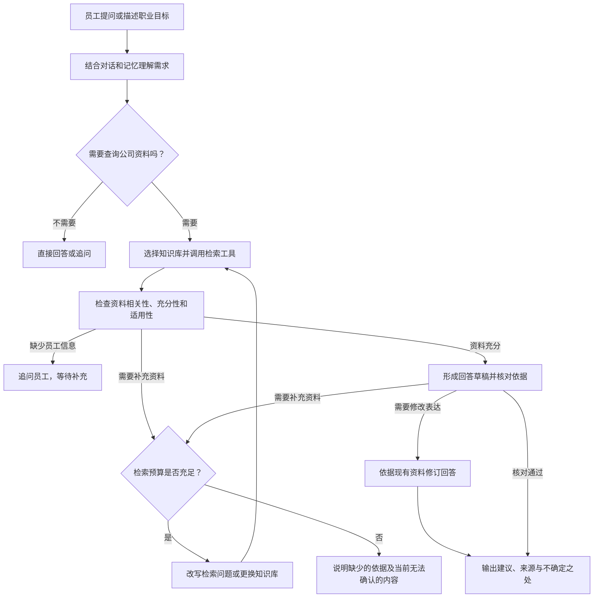

# 员工职业规划问答智能体：Agentic RAG 方案

> 日期：2026-11-15
>
> 状态：讨论方案，作为后续业务项目的设计起点；尚未开始实现。
>
> 技术起点：当前学习工程使用 `deepagents==0.7.34`，新项目选型时继续核对版本和实际模型兼容性。

## 1. 目标与使用方式

员工主动提问，或描述自己的工作经历、职业目标和困惑。Agent 结合当前对话及已确认的用户记忆，
自主判断是否需要查询公司资料、查询哪个知识库，以及资料是否足够回答问题。

需要检索时，通过工具查询公司规章制度、岗位要求、能力标准或培训资源。检索结果不足时，
可以改写检索问题、补充查询其他知识库，或向员工追问。最后给出回答、建议和相应依据。

项目同时承担实际业务探索和 Agent 学习的目的。所选能力应有明确用途，先完成单 Agent 的
工具选择、检索循环、结果核实、记忆和上下文管理，再根据真实案例判断是否需要扩展。

## 2. 架构选择

采用 **Deep Agents + Agentic RAG + 检索与回答校验**。

Agentic RAG 表示由模型决定检索时机、检索问题和工具选择；RAG loop 表示其中可重复执行的
检索与核实循环。本文不使用“RAG Pool”作为架构名称。

Self-RAG 和 Corrective RAG（CRAG）提供了按需检索、反思或纠正检索的相关研究思路。
本文采用这些思路进行工程设计，不宣称复现其论文算法；尤其 Self-RAG 包含专门的训练与反思标记，
不能仅增加一段自检提示词就认为完成了该方法。

Deep Agents 提供 Agent 运行循环、工具调用、Skill、记忆和上下文管理基础。
实际知识库检索、资料适用性判断规则和业务验收需要另外设计，框架不会自动保证回答正确。

## 3. 职责分工

| 部分 | 职责 |
|---|---|
| 主 Agent | 理解员工需求，决定是否检索、选择知识库、检查结果、继续行动并组织回答 |
| 职业规划 Skill | 规定如何处理职业问题、选择知识来源、核实资料、引用依据与说明不足 |
| 检索工具 | 执行真实查询，返回资料片段及结构化来源信息 |
| 知识库 | 提供经过整理的公司制度、岗位标准和培训资料 |
| 当前会话与上下文 | 保存本次交流中的问题、补充信息、工具结果和分析进度 |
| 长期记忆 | 保存用户确认的职业目标、背景或交流偏好，支持后续会话 |
| 业务后端 | 验证身份、限制资料访问、控制工具调用预算和数据读写权限 |

Skill 负责使用规范，工具负责执行查询。知识库名称可以由模型选择，但可访问的范围必须由
后端根据当前身份确定，不能依赖模型自行遵守权限。

## 4. 核心运行流程



不要求每个问题都检索。例如澄清问题、整理用户刚提供的信息和一般性交流，可以直接处理。
涉及具体公司规定的结论必须有可核对的公司资料支持。

## 5. 首版知识与检索工具

### 5.1 知识来源

可以先按内容区分以下逻辑知识库，实际划分根据公司资料决定：

- 晋升、转岗及职业发展制度。
- 岗位职责、任职资格和能力标准。
- 培训课程、认证要求及学习资源。

制度文档需要完成整理、切分和索引；向量库、现有知识库或其他检索服务均可作为工具底层。
模型面对稳定的工具接口，不直接承担索引维护。

### 5.2 工具接口

首版可提供一个带知识库类型参数的检索工具，例如：

```text
search_company_knowledge(query, kb_type)
```

也可以按知识库拆成独立工具。工具数量和参数结构待知识来源明确后确定，优先保证模型能正确理解和选择。

建议每条检索结果包含：

| 字段 | 用途 |
|---|---|
| 文档及片段 ID | 稳定定位引用内容 |
| 标题、章节或条款 | 让员工能够核对依据 |
| 原文片段 | 支持模型判断与回答 |
| 版本、生效时间 | 判断资料是否仍然适用 |
| 适用岗位、职级或人员范围 | 避免将其他群体的制度用于当前员工 |
| 来源位置 | 在权限允许的范围内提供可打开或可定位的出处 |

检索分数可辅助排序，但不等同于资料正确、适用或足以回答问题。

## 6. 两层核实

### 6.1 检索结果核实

Agent 取得资料后检查：

1. 相关性：是否针对当前问题与目标岗位。
2. 适用性：版本、时间、部门、岗位及人员范围是否匹配。
3. 充分性：是否覆盖主要问题，是否还需要其他资料。
4. 一致性：资料之间是否有冲突，是否需要进一步确定适用版本。

处理方式应对应具体不足：检索问题不准确就改写，缺少其他方面资料就补检索，缺少员工信息就追问。
连续没有找到有效依据时，明确说明不足。

### 6.2 回答核实

回答前检查：

- 是否回答了员工实际关心的问题。
- 公司制度相关的结论是否有检索依据，引用是否支持对应结论。
- 是否清楚区分公司要求、员工提供的信息与 Agent 的建议。
- 是否保留尚未确认的条件，避免直接作出缺乏依据的资格判断。

首版可由同一个主 Agent 完成这些检查，先通过 Skill 约束并在评估中检查实际效果。
若后续需要程序化强制校验，再加入独立校验步骤或中间件；不默认新增一个评审 Agent。
模型自检属于处理环节，仍需独立的业务案例验收，不能把模型自评当作准确率证明。

## 7. 职业规划 Skill 的内容

Skill 建议覆盖：

- 了解员工当前岗位、经历、目标和主要困惑。
- 按问题选择适当知识库，必要时拆分检索问题。
- 对公司制度相关断言提供资料依据。
- 检查资料的相关性、充分性、适用范围和版本。
- 资料不足时继续检索、追问或说明无法确认，不自行补造公司规定。
- 回答中区分制度事实、员工信息和职业建议。
- 记忆的保存范围、用户确认要求与纠正方式。

Skill 中描述这些业务原则；实际检索和存储通过工具完成。

## 8. 记忆与上下文管理

### 8.1 当前会话

使用对话历史理解连续提问。例如员工先说“我想转项目经理”，再问“需要哪些条件”，
应结合前文形成完整的检索问题。

使用检查点支持跨请求继续交流；长对话通过框架上下文管理处理。
实际模型的上下文上限、摘要效果和检索结果长度需要用真实案例验证。

### 8.2 长期信息

可保存员工确认的职业目标、背景和交流偏好。画像中的可核对事实适合保存为结构化业务字段；
长期记忆辅助对话连续性，具体画像结构待业务设计时确认。

使用边界：

- 用户事实与模型推测分别处理，不将推测自动变成员工事实。
- 公司规章制度以适用知识来源为准，不能用历史记忆代替当前制度依据。
- 用户能够查看、修改和清空自己的记忆，并按用户隔离。
- 当前学习工程的旧会话可能保留原记忆；新业务项目需明确记忆更新后的会话刷新策略。

## 9. 自主行为与停止边界

模型负责判断检索策略，业务代码执行必要边界：

- 身份与数据权限在后端验证，检索工具只返回当前用户有权访问的资料。
- 公司具体制度断言应有依据；无依据时说明无法确认。
- 对每轮提问设置检索次数、模型调用或运行时间预算，避免无效循环。
- 建议起点为每轮最多 3 次检索（首次检索加最多 2 次补检索），这是待实测调整的配置，不是已确定的业务要求。
- 到达预算、反复无新结果或资料存在未解决冲突时，结束当前检索并解释缺口或追问员工。
- 不默认启用公网搜索补充公司制度，外部信息不能充当公司的内部规定。

## 10. 首版范围与实施前准备

首版能力组合：

**单个 Deep Agent + 职业规划 Skill + 知识库检索工具 + 用户记忆 + 会话持久化 + 流式回答。**

结构化规划结果可在具体输出要求明确后加入。
子 Agent、沙箱、复杂审批与异步任务暂不作为首版前提。

正式业务拟另建项目并复用当前学习工程的模型连接、Agent 组装、登录、用户隔离、
会话、记忆管理和流式能力。当前学习工程保留，不在此文档任务中创建新项目或修改业务代码。

实施前需要确认：

1. 真实资料及检索服务的来源、格式、更新方式和权限范围。
2. 员工背景从对话收集还是连接已有系统，哪些信息需要长期保存。
3. 实际模型对工具选择、连续调用、Skill 和结构化结果的支持情况。
4. 代表性的员工问题、预期引用和可接受回答，以及延迟和调用预算。

## 11. 验收案例方向

| 场景 | 期望行为 |
|---|---|
| 一般交流或澄清 | 可直接回答或追问，不无意义检索 |
| 明确查询公司制度 | 调用对应知识库，回答附依据 |
| 跨知识库的职业问题 | 按需取得岗位要求、制度和培训资料，综合回答 |
| 多轮省略提问 | 结合前文形成完整检索问题 |
| 首次资料不相关 | 调整查询后再检索，保留最终有效来源 |
| 缺少员工信息 | 追问，不将信息缺失误判为不满足条件 |
| 资料不足、过期或冲突 | 说明限制，补检索或停止，不编造制度 |
| 重复检索无进展 | 在预算内终止并解释不足 |
| 不同员工访问 | 工具、会话和记忆均遵守后端权限 |
| 记忆被修改 | 后续回答按已定义的刷新策略使用最新信息 |

通过真实案例记录工具选择、检索结果、引用、回答和调用成本，再判断是否需要增加其他 Agent 能力。

## 12. 参考资料

以下为方案讨论时参考的官方文档与原始论文，具体 API 以项目固定版本为准：

- [LangChain：检索与 Agentic RAG](https://docs.langchain.com/oss/python/deepagents/retrieval)
- [Deep Agents 概览](https://docs.langchain.com/oss/python/deepagents/overview)
- [LangChain：Context Engineering Starts with Retrieval](https://www.langchain.com/blog/context-engineering-starts-with-retrieval)
- [Self-RAG 原始论文](https://arxiv.org/abs/2310.11511)
- [Corrective Retrieval Augmented Generation 原始论文](https://arxiv.org/abs/2401.15884)
