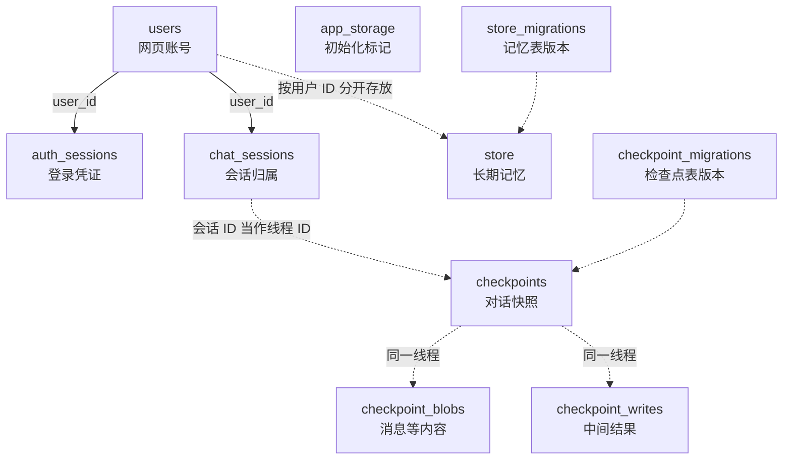

# deep_agent 应用数据库说明

日期：2026-11-19。

网页应用的运行数据在 PostgreSQL 数据库 `career` 的 `deep_agent` 模式中。这里只有登录、会话和记忆，不含证书政策资料。政策正文在 `career.public`，向量在 Milvus 的 `career.career_policy_sections`。

## 表

| 表 | 作用 |
|---|---|
| `users` | 网页登录账号，含用户名和密码校验值 |
| `auth_sessions` | 登录凭证和过期时间，用来判断浏览器是否仍处于登录状态 |
| `chat_sessions` | 聊天会话归哪个用户，以及会话列表的排序 |
| `checkpoints` | 每一轮对话的执行快照，用来恢复聊天 |
| `checkpoint_blobs` | 快照里放不下的具体内容，例如消息正文 |
| `checkpoint_writes` | 一轮还没走完时记下的中间结果，恢复时接着用 |
| `checkpoint_migrations` | 检查点相关表的结构升级记录 |
| `store` | 每个用户的长期记忆 |
| `store_migrations` | 长期记忆表的结构升级记录 |
| `app_storage` | 记录这套应用表是否已经初始化，服务启动时会先看它 |

## 关系

实线是数据库外键。库里实际只有两条：`auth_sessions.user_id` 和 `chat_sessions.user_id` 指向 `users.id`。

虚线是程序按 ID 对应的用法，库里没有外键。会话 ID 当作 LangGraph 的线程 ID，用来找到该会话的快照、消息内容和中间结果。长期记忆按用户 ID 分开存放。`app_storage` 不和其他表关联，服务启动时用它确认这套表已经初始化。

## migrations

`checkpoint_migrations` 和 `store_migrations` 是 LangGraph 的升级笔记。`checkpoints`、`checkpoint_blobs`、`checkpoint_writes` 和 `store` 的表结构由 LangGraph 建立。框架升级后如果要给这些表加字段，它先看笔记里记到了第几版，缺哪一版就补哪一版，已经做过的不会再做一遍。

笔记里只有版本号。2026-11-19 查看时，检查点相关表执行过版本 0 到 9，长期记忆表执行过版本 0 到 3。

这两张表和证书咨询、聊天内容、用户账号无关。业务代码不读取里面的内容。
